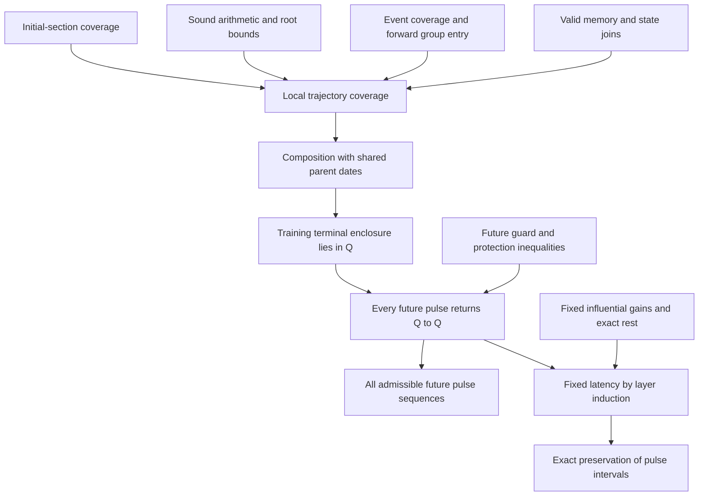

# A22 — A walkthrough of the learning-to-transmission proof

**How a finite enclosure of learning supports an exact statement about every future pulse sequence.**

This guide explains the v3.3 argument for the 216-cell network. Start with the one-page overview, follow the five propositions, then use the source map to inspect individual obligations. Later depth and random-medium results have separate reading routes at the end.

**Proof status.** The repository supplies a manual mathematical and source-level proof under execution assumptions A1–A4. Its numerical checks support particular finite inequalities and artifact identities. The argument has not been independently reviewed by an expert or machine-checked in a proof assistant.

Source snapshot: [commit `7133335`](https://github.com/HevisNico/a22-interval-replay/tree/7133335109b11b64ed8b7a94a584f30674fce128), consulted 25 October 2026. The links below point to that snapshot, so later repository changes do not silently alter their targets.

## 1. The result in five minutes

A22 is a feedforward network of 18 layers, each with 12 cells. Each cell receives pulses from three neighboring lanes in the preceding layer. A cell accumulates charge, fires at a threshold, closes its main input during a protected phase, and eventually reopens at an exact resting charge. Local auxiliary circuits change its input gains and recovery variable.

The question is whether the stated learning protocol reliably establishes a regime that preserves the timing between source pulses, despite uncertainty in the device and its initial state.

The family considered here has independently chosen physical constants for each port of each cell, within the specified relative ±10⁻⁴ intervals, and initial perturbations of size 10⁻⁵ as defined by the model. Each physical device keeps its chosen constants throughout its trajectory. Initial auxiliary phases are restricted to the permitted READY or terminal-ERROR states, with no hidden earlier input history.

Training consists of 128 canonical pulses on source lane 0 at times $8k$, for $0\leq k<128$. The terminal observation is at $T=1116$. Future inputs use the same canonical pulse shape, with successive source pulses at least 20 time units apart.

Under A1–A4, the supplied proof concludes:

| Stage | Statement for every permitted device and initial state |
| --- | --- |
| Learning | The recorded computation encloses the entire training trajectory and its emissions. At time 1116, the state belongs to an explicit resting domain $Q$. |
| Each future pulse | Each of the 191 active cells fires exactly once; the other 25 remain silent. The whole network returns to $Q$ before 12.791 time units have elapsed. |
| Every future pulse sequence | For each active cell, the output firing times equal the source times plus one fixed latency. All successive time intervals are therefore preserved exactly. |

For one fixed device and one learned entry state, write the source times as $s_k$. The conclusion for active cell $v$ is

$$
F_{v,k}=s_k+d_v,
\qquad
F_{v,k+1}-F_{v,k}=s_{k+1}-s_k.
$$

The latency $d_v$ may differ between cells, devices and learned entry states. The equality concerns successive pulses within one such realization.

**Why exact equality can follow from interval calculations.** The intervals certify the conditions needed for each new pulse to encounter the same response equation. Once those conditions hold, time translation gives the equality symbolically. The equality itself is not inferred from two numerically close output intervals.

The result concerns this ideal hybrid model, its stated uncertainty box and its prescribed inputs. It does not establish robustness for physical hardware, arbitrary waveforms or arbitrary initial preparations.

## 2. The proof at a glance

There are two main arguments to connect: coverage during learning, and return to rest after learning. The terminal enclosure connects them.



*Figure 1. Logical dependencies. Each box names a proof obligation; a successful computation alone does not discharge all of them.*

The distinction between physical trajectories and their numerical representation matters throughout. An enclosure may contain possibilities that no physical device realizes. This is harmless if it retains every admissible physical trajectory. Removing an actual possibility would break coverage.

## 3. Five propositions that carry the argument

### Proposition 1 — The initial representation covers every allowed starting state

Some auxiliary circuits may initially be finishing an ERROR phase. Starting all of them at rest would change the problem. The proof instead encloses a short initial time slab, ending at $U_0$, long enough to include every permitted residual ERROR phase.

Uniform bounds show that these residual phases end within the slab, account for the charge and gain changes they can cause, and keep the relevant charges below threshold. Source-pulse tails still active at the slab endpoint are retained. The first auxiliary delay is enclosed separately from later delays, which begin from auxiliary rest.

This is a conservative propagation of the initial family. No physical reset is introduced to simplify it.

**What this supplies:** a valid starting representation for the cell-by-cell learning argument.

**Read the details:** learning-coverage theorem, §7; the [initial-section checker][initial-check] supplies the associated finite inequality checks.

### Proposition 2 — Every successful learning step retains the physical trajectory

Fix a physical device and an allowed initial state. At each live control point, the proof maintains five linked facts, summarized below.

| Invariant | Meaning |
| --- | --- |
| I1: dates | Each represented date contains its physical value, and a shared time identity means the same date everywhere. |
| I2: state and mode | The continuous variables are enclosed, the discrete modes are correct, and a due firing has not been forgotten. |
| I3: actuator history | At least one retained history represents the actual gated gain and recovery changes. |
| I4: READY memory | If a memory representation is kept, its anchor and pulse history describe the actual charge response. Without it, the scalar state still encloses the charge. |
| I5: events and emissions | The remaining queue contains every pending exterior action; the output prefix contains every physical emission already produced. |

The proof then examines the operations that can advance this representation: continuous flow, threshold isolation, event groups, local-cycle resolution, permitted commutations and branch joins. Arithmetic must enclose the correct values; event handling must preserve an admissible physical order; joins must retain the relevant histories and dates.

When the program cannot establish a necessary bound or represent an unresolved case safely, it must refuse to certify the cell. A resource limit or an exception cannot silently become a successful truncated result. Assumption A3 and the reviewed runner behavior make that distinction explicit.

The proof is tied to the effective v3.3 program and the recorded campaign. Some functions are replaced when the engine loads, so the effective source views are relevant reading material. The argument about the 202 recorded commutations is specialized to their recorded event pattern; it is not a blanket correctness claim for every imaginable commutation.

**What this supplies:** induction over a completed cell computation, covering its entire physical output history and terminal state. The three most delicate parts are explained in §4 below.

**Read the details:** [learning-coverage theorem][learning], §§3–9, and the [forward group-entry lemma][group-entry].

### Proposition 3 — Local coverage composes across all 18 layers

A valid enclosure for each cell is not enough if different children are allowed to reinterpret their common parent's pulse as different physical events.

The composition argument preserves one assignment of physical parameters and existing time identities. Each child receives the same authenticated parent emission definitions. It may introduce fresh local coordinates to express additional enclosure uncertainty, but it cannot change the physical parent dates already used elsewhere.

The source dates are exact. Starting there, induction across the acyclic graph gives joint coverage of all 216 cells. The result is a network enclosure with consistent shared events, rather than a collection of independently resampled cell marginals.

**What this supplies:** every admissible training trajectory belongs to the joint terminal enclosure $S_{18}$ at time 1116.

**Read the details:** [learning-coverage theorem][learning], §10.

### Proposition 4 — The training terminal enclosure enters the resting domain Q

The terminal extraction, together with the physical phase and cap constraints, places the covered physical states in $Q$. The domain includes much more than learned gain intervals.

At a state in $Q$, principal and auxiliary modes are READY, and no physical pulse or delayed current remains active. Each active main charge is exactly at its reset rest value $r$; each active input auxiliary is exactly at $r_m$. Silent charges remain in certified subthreshold intervals containing their relaxation equilibria. The domain also constrains gains, recovery and energy.

Its gain classification anticipates the future argument:

| Port class | Count | What may happen during future operation |
| --- | ---: | --- |
| Influential active | 525 | Gains remain fixed and determine the response before firing. |
| Masked active | 15 | Gains may increase up to their physical caps; their pulses arrive after the certified firing. |
| Silent | 108 | No incoming pulse acts on these ports; their gains remain fixed. |

The recovery variable may also increase within its allowed bounds. Thus the future theorem does not require every internal variable to stop evolving.

Combining the first four propositions yields the training-entry statement:

$$
H_{\mathrm{entry}}:\quad
\mathrm{Reach}_{\mathrm{training}}(1116)\subseteq Q.
$$

**What this supplies:** the premise needed to apply the future theorem to every trajectory of the stated training family.

**Read the details:** [learning-coverage theorem][learning], §10, and [future-invariance proof][future], §A.

### Proposition 5 — Q returns to itself, and the response has fixed latency

Consider one future source pulse. Starting from $Q$, finite, strict inequalities establish a first upward threshold crossing in every active cell, before any active incoming raw pulse ends. Masked ports arrive after that crossing and do not affect it.

For every influential port, its ERROR phase starts after the main firing and finishes before main reopening. Its gain therefore cannot change during that wave: the principal protection closes the gain-actuation gate throughout that ERROR phase. All active raw pulses also finish before reopening, including masked pulses.

| Landmark for a cell | Certified relationship | Consequence |
| --- | --- | --- |
| Incoming raw pulse | Its arrival supplies charge while the principal is READY. | Influential inputs determine the first response. |
| Main firing $F$ | Occurs before any active raw pulse ends. | The main cell enters FAST protection and emits one pulse. |
| Influential ERROR onset | Strictly after $F$, and after that port's raw pulse has ended. | Its gain was fixed throughout the response before firing. |
| FAST-to-SLOW boundary | At $F+1$; both phases keep the same relevant gates closed. | ERROR need not be ordered relative to this boundary. |
| Main reopening | After every active raw-pulse end and every influential ERROR end. | Charge reopens at $r$, with no raw current left to trigger a second firing. |
| Global rest | Before $s+12.791$ for a source pulse at $s$. | More than 7.209 units remain before the earliest next source pulse at $s+20$. |

*Figure 2. Timing constraints for a future wave. This is a partial chronology: arrivals on different ports may overlap, and ERROR need not lie wholly within FAST or wholly within SLOW. Masked ERROR may extend past reopening; its gain is allowed to change.*

The bounds ensure that every cell and auxiliary cycle settles in time, that all relevant variables remain within the domain bounds, and that the network returns to $Q$. Extra idle time preserves $Q$. Writing $P_h$ for a one-pulse return map with source spacing $h$,

$$
P_h(Q)\subseteq Q\qquad\text{for every }h\geq20.
$$

Induction gives the result for any finite future pulse sequence. Gaps of at least 20 prevent source events from accumulating in finite time; the finite feedforward network and finite within-wave event count also exclude an internal accumulation. The result extends to admissible infinite sequences.

Now fix the device and its entry state. The influential gains stay fixed. Each active cell begins each future response at the same exact main resting charge. If its parents fire at source-relative latencies $d_i$, its charge before the threshold is

$$
q(s+u)=r+\sum_i G_i h_+(u-d_i),
$$

where the sum is over influential parents and $h_+$ is the causal single-pulse response on the certified interval before any raw-pulse end. This expression is independent of the absolute source time $s$. Its certified first crossing therefore has the same latency on every wave.

Layer induction gives $F_{v,k}=s_k+d_v$. Subtracting consecutive firing times proves exact interval preservation.

**A useful distinction:** $Q$ is a resting section. During a pulse the network leaves that section. Continuous-time invariance concerns the larger hybrid tube containing the certified wave segments, their modes and clocks, and the resting states between pulses.

**Read the details:** [future-invariance proof][future], §§B–G; [exact word-preservation argument][word]; [learning-coverage theorem][learning], §11.

## 4. Three technical points worth inspecting closely

### A. Why a weak numerical comparison can certify strict event order

**The difficulty.** An accepted bound such as $x-t\geq0$ would ordinarily allow simultaneous events. The ordinary uncertain-root path needs a reason why its accepted comparison actually excludes physical equality.

**The idea.** The open-image lemma freezes the old physical and time coordinates. A fresh expanded exponential or logarithm supplies representational freedom on both sides of its actual value. The proof follows that freedom through operations whose dependence on the selected value is affine with nonzero coefficient, or locally continuous and strictly monotone.

The root argument then shows that the retained enclosures contain an open neighborhood of the true root with old data fixed. If a compared exterior event were truly simultaneous, the difference enclosure would extend to both sides of zero. It could not pass the accepted nonnegative lower-bound test.

**What must be checked.** Freshness of the selected coordinates; evaluation order of derivative and guard; every retained refinement output; and the rounded-zero-midpoint case. Fixed FAST/SLOW boundaries have separate treatment. The commutation fallback based on first-crossing slice coverage also has its own argument.

**Source:** [learning theorem][learning], §§4–6 and §8(vi); [review task 1][review].

### B. Why ambiguous event orders do not lose a trajectory

**The difficulty.** Overlapping time enclosures can represent different physical orders, including equal times. Picking an order by sorting midpoints would not cover the whole family.

**The idea.** The algorithm retains orders compatible with the bounds and automata. The proof checks that the actual physical order survives each successful path, that threshold crossings are accounted for, and that groups begin at physically forward times.

**What must be checked.** Every successful ordinary and macro exit, group boundaries, zero-duration cases, and emission handling at joins. Clipping a duration to a nonnegative number does not by itself prove that an artificial group clock lies after the current state. The companion group-entry lemma supplies that control-path argument.

**Source:** [learning theorem][learning], §8; [group-entry lemma][group-entry]; [review task 2][review].

### C. Why merging branches preserves the meaning of memory

**The difficulty.** A memory contains a charge response anchored at a particular time. Matching labels alone do not justify merging different restricted anchors or retaining the first branch's discrete fields.

**The idea.** The proof inspects reachable callers. Some joins inherit common anchor and origin objects. Separately recomputed local returns receive distinct fresh time atoms, so incompatible memories are dropped. Removing that memory correlation is conservative because the scalar charge enclosure remains.

**What must be checked.** The retained mark/error origins, firing identity, raw-input state and memory anchor must be compatible across the joined branches. This is a claim about the actual successful call sites, not arbitrary invented memory objects.

**Source:** [learning theorem][learning], §§6 and 9; [review task 3][review].

## 5. What the proof assumes, and what the checks establish

The manual proof explicitly retains the following execution assumptions. These summaries do not replace their full wording in §2 of the [learning theorem][learning].

| Assumption | Trusted execution condition |
| --- | --- |
| A1 | The recorded execution had the authenticated effective v3.3 semantics, without unrecorded replacement or mutation. |
| A2 | Python, Decimal and native arithmetic obey the stated contracts; memory and storage behave correctly. Compiler correctness and native binary/source equivalence are not formally proved. |
| A3 | Assertions and failure handling are active; unsupported cases, failed bounds, exceptions and resource limits cannot become successful cell results. |
| A4 | Producer namespaces remain distinct, counters are not reset within a cell, port contexts are handled serially and restored, and shared parent definitions are consistently loaded. |

Different checks answer different questions:

| Evidence | What it supports | What it does not establish by itself |
| --- | --- | --- |
| Source and binary identities, receipts and lineage | Correspondence between the reviewed artifacts and the recorded campaign data | Mathematical correctness of trajectory coverage |
| Source-witness checks | Specific structural and hash facts in the effective program | Semantic verification of the manual proof |
| Independent future inequality checkers | The finite guard, protection and return inequalities used after entry into $Q$ | Coverage of every training event branch |
| Manual invariant and composition argument | The claimed link from every allowed initial trajectory to the terminal domain | Completed independent expert review or proof-assistant verification |

The future checkers use different arithmetic and series implementations. One constructs and checks bounds; the other rechecks supplied brackets and inequalities without doing the same root search. Their agreement is useful evidence for the future inequalities, with the stated trusted basis.

## 6. Read or verify one piece at a time

| Your question | Start here |
| --- | --- |
| What exactly is the physical model? | [Model reference][model], §§1–6 and 8; first read its [status note][model-status] for historical statements. |
| Why does learning coverage hold? | [Learning theorem][learning], §§3–10. |
| What is the most consequential local lemma to review? | [Review task 1][review], then learning-theorem §§4–6. |
| Why are future intervals preserved exactly? | [Word-preservation argument][word], especially “Proof of fixed latency and exact word preservation.” |
| Which status should I use? | [Proof STATUS.json][status] and the [proof README][proof-readme]. |
| What must I download to reproduce the checks? | [Proof files omitted from the repository][omitted] and the [v3.3-proof release][release]. |

For the passive proof checks, use the complete extracted proof dossier described by the repository, with ordinary Python 3 and assertions enabled. From that dossier's root:

```bash
python3 learning_justification/verify_build_identity.py
python3 learning_justification/verify_source_witnesses.py
python3 kernel_soundness/extract_effective_source.py
python3 kernel_soundness/check_contract_countermodels.py
python3 provenance_audit/certify_future.py provenance_audit/output/all_terminal_exact.json future_recheck.json
python3 provenance_audit/verify_future_certificate.py provenance_audit/output/all_terminal_exact.json future_recheck.json independent_recheck.json
python3 final_entry_audit/certify_initial_section.py initial_recheck.json
```

These commands reproduce specified artifact and inequality checks; they do not launch a new learning campaign. They were transcribed from the source documentation, not executed while preparing this walkthrough. The contract countermodels concern insufficient weaker proof contracts; their existence is not reported as a counterexample to the recorded campaign.

### Reading historical “OPEN” statements

Some preserved files, including the global word-preservation document and the earlier training-entry review, state that $H_{\mathrm{entry}}$ remains open. The future-invariance document likewise presents entry as a separate obligation. These reflect the earlier stage of the dossier.

The current learning-coverage theorem supplies the claimed discharge of that obligation under A1–A4, at the manual proof level. Its current [status record][status] explicitly retains the need for independent expert review or formal verification. Earlier files remain useful for their future arguments and for the audit trail; their historical status sentences should be read with the current notice. Their bytes are preserved because their hashes are referenced elsewhere.

## 7. Separate routes for later results

The five-proposition route above concerns the v3.3 training family and its 18-layer future regime. Later results introduce additional questions and hypotheses:

| Topic | Reading route | Scope to keep visible |
| --- | --- | --- |
| Arbitrary depth | [Depth overview][depth] | Certified finite preparations connect to tail theorems. |
| Random media | [Ergodic extension][ergodic] | Limiting-speed statements use stationary ergodic medium assumptions. |
| Entry for every preparation | [Point 4][point4] | Universal entry for the original source remains an open problem. |
| Relative gain domain | [G_rel dossier][grel] | Conditional future invariance on an admissible gain domain; not universal training entry or a complete ±1% learning campaign. |

These are follow-on reading paths. None is needed to understand the v3.3 chain from covered learning, through entry into $Q$, to exact future interval preservation.

[learning]: https://github.com/HevisNico/a22-interval-replay/blob/7133335109b11b64ed8b7a94a584f30674fce128/proof/learning_justification/output/LEARNING_COVERAGE_THEOREM_EN.txt
[group-entry]: https://github.com/HevisNico/a22-interval-replay/blob/7133335109b11b64ed8b7a94a584f30674fce128/proof/learning_justification/output/GROUP_ENTRY_CLOCK_LEMMA_EN.txt
[initial-check]: https://github.com/HevisNico/a22-interval-replay/blob/7133335109b11b64ed8b7a94a584f30674fce128/proof/final_entry_audit/certify_initial_section.py
[future]: https://github.com/HevisNico/a22-interval-replay/blob/7133335109b11b64ed8b7a94a584f30674fce128/proof/FUTURE_INVARIANCE_PROOF_EN.txt
[word]: https://github.com/HevisNico/a22-interval-replay/blob/7133335109b11b64ed8b7a94a584f30674fce128/proof/GLOBAL_THEOREM_AND_WORD_PRESERVATION_EN.txt
[review]: https://github.com/HevisNico/a22-interval-replay/blob/7133335109b11b64ed8b7a94a584f30674fce128/REVIEW.md
[model]: https://github.com/HevisNico/a22-interval-replay/blob/7133335109b11b64ed8b7a94a584f30674fce128/engine/reference/full_model_reference.md
[model-status]: https://github.com/HevisNico/a22-interval-replay/blob/7133335109b11b64ed8b7a94a584f30674fce128/engine/reference/STATUS_NOTE_EN.md
[status]: https://github.com/HevisNico/a22-interval-replay/blob/7133335109b11b64ed8b7a94a584f30674fce128/proof/STATUS.json
[proof-readme]: https://github.com/HevisNico/a22-interval-replay/blob/7133335109b11b64ed8b7a94a584f30674fce128/proof/README_EN.txt
[omitted]: https://github.com/HevisNico/a22-interval-replay/blob/7133335109b11b64ed8b7a94a584f30674fce128/proof/OMITTED_IN_REPOSITORY.md
[release]: https://github.com/HevisNico/a22-interval-replay/releases/tag/v3.3-proof
[depth]: https://github.com/HevisNico/a22-interval-replay/blob/7133335109b11b64ed8b7a94a584f30674fce128/depth/README.md
[ergodic]: https://github.com/HevisNico/a22-interval-replay/blob/7133335109b11b64ed8b7a94a584f30674fce128/depth/ergodic/README_EN.md
[point4]: https://github.com/HevisNico/a22-interval-replay/blob/7133335109b11b64ed8b7a94a584f30674fce128/depth/point4/README.md
[grel]: https://github.com/HevisNico/a22-interval-replay/blob/7133335109b11b64ed8b7a94a584f30674fce128/depth/g_rel/README.md
