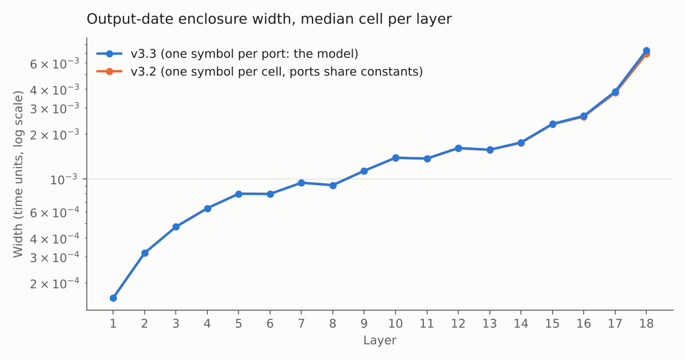

# A22 — enclosing every learning trajectory of a 216-cell spiking network, with a manual proof

**Contribution.** This repository contains a computer-assisted enclosure of **all admissible
trajectories** of a learning spiking network during its full 128-pulse training transient, together with
a written proof that the computation covers them and that the learned state is then **invariant for
every admissible future input**. The network has 216 coupled hybrid cells (18 layers × 12 lanes) with:
- uncertain physical parameters (±1e-4 relative), **independent for each input port of each cell**;
- uncertain initial states (±1e-5);
- evolving learned gains and a recovery actuator;
- threshold crossings, and events whose order may vary.

**The result**, for every fixed device in the parameter box and every admissible initial state (proof in
[`proof/`](proof/), under the execution assumptions A1–A4 stated there):

1. **Training.** After the 128 training pulses (times 8k, horizon 1116), the network is in an explicit
   quiescent domain Q. The learned gains are determined to within ±2.4 % in the worst cell, and the
   training spike dates to within 7.3e-3 time units for the median cell of the last layer.
2. **Afterwards, forever.** From Q, for every future sequence of source pulses spaced by at least 20:
   each of the 191 active cells fires **exactly once** per pulse, the whole network is back at rest
   within 12.791 time units, and the network returns to Q.
3. **Exact transmission.** Each active cell answers with a fixed latency, so the intervals between
   pulses are transmitted **exactly** through all 18 layers. The latencies depend on the device and on
   the learned gains; they are not claimed to be equal across devices.

So in this realization, a learning process with local rules installs, despite physical variability, a
regime that transmits temporal patterns exactly. Point simulations can suggest this; they cannot
establish it.

> **Made with AI.** The code, the diagnostics and the written proof were produced with Claude
> (Anthropic) and ChatGPT (OpenAI) under the author's direction (see [How this was built](#how-this-was-built)).
>
> **Status.** The computation is complete, reproducible and bound to its exact code by hashes. The
> coverage and invariance argument is a **manual mathematical proof under explicit execution
> assumptions** (A1–A4: authentic execution of the recorded program, correct arithmetic runtime and
> native binary, fail-closed assertions, namespace discipline). It has **not yet been reviewed by an
> independent expert** and is not machine-checked. The archived software status remains
> `experimental_not_qualified`. Review is welcome: see **[REVIEW.md](REVIEW.md)**.

| | |
|---|---|
| Layers completed / cells | 18 / 216, each layer re-read by a separate verifier process |
| Campaign identity | `kernel_id` **reproduced exactly** from the published sources and the two archived binaries |
| A14 reference gain boxes inside our enclosures | **648 / 648** (exact rational test) |
| Independent H1/H2 re-check, layer 18 lanes 1, 4, 8, 11 | 418 / 418 spikes and 3,600 / 3,600 "no spike" decisions re-proved |
| Output-date width, median cell, layer 18 | 7.3e-3 time units (worst cell: 3.8e-2) |
| Learned gains, worst relative half-width | ±2.4 % (cell 18,6) |
| Future regime (from Q) | 191 active cells, one spike each per pulse; network at rest within 12.791; margin > 7.209 before the next pulse |
| Future-domain inequalities | checked by two independent programs (different arithmetic, no engine import) |
| Critical-path time, 8 workers | 49 min in total (layer 18: 24 min) |



*Median output-date width per layer during training. v3.3 treats each port's constants as independent,
as the model specifies; v3.2 shared them across the three ports of a cell. The more general model costs
at most 5 % of width (layer 18: 7.28e-3 against 6.91e-3).*

## Origin of the model

The physical kernel of A22 is inspired by the **Reset Operator** of Nicolas Breuillaud (*The Reset
Operator: A Structural Constraint on Recursivity*, manuscript, 2026). After each threshold crossing, the
operator opens a finite interval of reduced admission while internal dynamics restore a below-threshold
state. A22 is one concrete realization of this structure: READY, fast and slow phases; admission closed
after firing; return to rest before admission reopens. The full model is
[`engine/reference/full_model_reference.md`](engine/reference/full_model_reference.md).

The result is about this realization and its parameter box. It is not a proof of the Reset Operator
hypothesis in general (see [`docs/MODEL_BOUNDARY_EN.txt`](docs/MODEL_BOUNDARY_EN.txt)).

## How the proof is organized

The chain is: **initial section → every training step → terminal domain Q → every future wave.**

| Step | Where | How it is established |
|---|---|---|
| Initial section [0, U0] | `proof/final_entry_audit/` | analytic lemma + independent integer inequalities |
| Every training step of every cell | `proof/learning_justification/output/LEARNING_COVERAGE_THEOREM_EN.txt` | relational invariant (I1–I5) preserved by every successful program step; open-image lemma for strict root order; event coverage; memory joins |
| Entry into event groups | `proof/learning_justification/output/GROUP_ENTRY_CLOCK_LEMMA_EN.txt` | case split on the control paths |
| Composition over the 18 layers | same theorem, Section 10 | feedforward induction with shared parent identities |
| Training end ⊂ Q | same theorem, Sections 10–11 | exact terminal extraction (216 authenticated results) |
| Q → Q for every future pulse | `proof/FUTURE_INVARIANCE_PROOF_EN.txt` | analytic argument + two independent inequality checkers |
| Exact transmission of the pulse word | `proof/GLOBAL_THEOREM_AND_WORD_PRESERVATION_EN.txt` | fixed influential gains + layer induction |

Start with [`proof/learning_justification/output/REVIEW_GUIDE_EN.txt`](proof/learning_justification/output/REVIEW_GUIDE_EN.txt).

## What was closed

The A14 reference (`results/reference_A14_gain_boxes.json`) lists one item as **unclosed**: *"A validated
interval replay of the complete 128-pulse learning transient from the initial state."* This campaign is
that replay. It agrees with the reference on all 648 learned-gain boxes. Those reference gains were
observed numerically with parameters within 1e-8, a set that lies inside the parameter box used here.

## Version history in one paragraph

The **v3.2** campaign (kept in [`history/v3.2/`](history/v3.2/)) completed, but it gave the auxiliary
constants of a cell (LM, LS, LE, M, C) **one** symbol shared by its three ports. The author found, with
an exact counterexample, that the model makes them independent per port; v3.2 therefore covered only a
sub-family. A first correction replaced the shared symbols by plain interval boxes. That is sound, but
it forgets that a port keeps the same constant at every pulse: enclosures grew 3–10× and the campaign
stopped at layer 18 ([`history/plain_box_package/`](history/plain_box_package/)). **v3.3** gives each
port its own symbol, used only for that port's quantities. It is the campaign reported and proved here.

## Reproduce

**The proof checks** (no engine import, no campaign): download the complete proof dossier from the
Release `v3.3-proof`, unzip it, and run from its folder, with Python 3 and without `-O`:

```
python3 learning_justification/verify_build_identity.py      # identities and kernel_id
python3 learning_justification/verify_source_witnesses.py    # 110 source facts
python3 kernel_soundness/extract_effective_source.py         # code as actually executed
python3 kernel_soundness/check_contract_countermodels.py
python3 provenance_audit/certify_future.py provenance_audit/output/all_terminal_exact.json future_recheck.json
python3 provenance_audit/verify_future_certificate.py provenance_audit/output/all_terminal_exact.json future_recheck.json independent_recheck.json
python3 final_entry_audit/certify_initial_section.py initial_recheck.json
```

**A new campaign** (requirements: Linux x86-64, CPython 3.12, a C compiler, OpenSSL development headers,
NumPy 2.3.5, SciPy 1.17.0):

```
cd engine
python -m pip install -r requirements.txt
python build_all_native.py
python -B -m unittest discover -s tests                 # 77 tests
python launch_fresh.py --out results/A22_v33_001        # 8 workers by default, ~12 GiB RAM
```

A new build produces new native binaries, so a new campaign has a different `kernel_id`; the proof is
about the recorded campaign. See [results/HASHES.md](results/HASHES.md) for both program identities.

## Contents

| Path | What it is |
|---|---|
| `proof/` | The proof dossier (theorems, lemmas, certificates, audit outputs, scripts); see `proof/OMITTED_IN_REPOSITORY.md` |
| `engine/` | The exact v3.3 program sources used for the campaign (physics kernel unchanged since the first release) |
| `tools/` | The read-only check scripts (same files as `engine/tools/`) |
| `results/campaign_summary.json` | Per-layer and per-cell summary of the campaign (timings, widths, gains, A14 inclusion) |
| `results/h1h2_layer18_lanes_1_4_8_11.json` | Independent re-check of every spike decision in four layer-18 cells |
| `results/layers_cells_and_timings.json` | Per-layer `cells.tsv` rows and `complete.json` of the campaign, in one file |
| `results/campaign_identity.json` | Campaign identity (run_id, kernel_id, environment) |
| `results/reference_A14_gain_boxes.json` | Independent reference gains (exact fractions) |
| `results/v2_refusal_layer18_lane4.json` | The layer-18 refusal of the v2 engine, kept for the record |
| `results/HASHES.md` | Identities, exact provenance reconstruction, file and Release-asset hashes |
| `history/` | The v3.2 campaign and the plain-box refusal records |
| `docs/DETAILS.md` | Method, fixes, results by layer, checks, limitations |
| `docs/AUDIT_EN.txt`, `docs/MODEL_BOUNDARY_EN.txt` | Earlier arithmetic audit; scope of the model |
| `REVIEW.md` | Call for review: self-contained tasks, most important first |
| `figures/` | Figures (PNG and SVG) |

## How this was built

This work was done with two AI assistants, **Claude** (Anthropic) and **ChatGPT** (OpenAI), under the
author's direction. The model, the Reset Operator and the research questions are the author's. Claude
and ChatGPT wrote and corrected the code, ran the diagnostics, drafted the proof (mainly ChatGPT) and
audited it (mainly Claude); each also re-checked the other's work. The author designed the model, found
the port-independence gap with an exact counterexample, ran the campaigns, and directed and validated
the work. This is why the repository does
not ask to be taken on trust: the campaign is bound to its exact code by reproducible hashes, every layer
is re-read by a separate process, critical decisions are re-proved by independent scripts, the results
are compared with an independent reference, and the proof states its assumptions explicitly. What it
still needs is review by human specialists.

## License and citation

Code (`engine/`, `tools/`, scripts in `proof/`, the engine ZIP in `history/v3.2/`): MIT, see `LICENSE`.
Documentation, proofs, figures and results: CC BY 4.0, see `LICENSE-docs.md`. To cite, use
`CITATION.cff` (GitHub's "Cite this repository" button).
