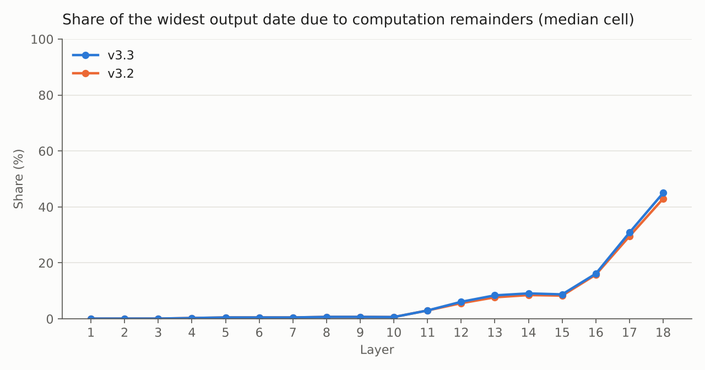

# A22 interval replay — details

## Method

Each cell (layer *n*, lane *j*) is a hybrid automaton: a READY phase in which input pulses charge *q*
toward the threshold 1, a fire, a protected fast phase of duration 1, then a slow recovery phase.
Learned gains and a recovery actuator *b* evolve in the background. Each cell reads the emitted spike
dates of lanes *j−1, j, j+1* of the previous layer through its ports 0, 1, 2. Layer 1 receives 128 exact
pulses spaced by 8. The physics kernel (`engine/kernel/`) is byte-identical to every earlier release.

**Uncertain inputs.** Every cell has its own parameters, independent of every other cell:
- for **each port** *i*, the auxiliary constants LM_i, LS_i, LE_i, M_i and C_i at ±1e-4 (relative),
  independent between ports, as the model specifies (`engine/reference/full_model_reference.md`);
- the initial state q, z0..z2, b at ±1e-5;
- three first-monitor delays, one per port.

**Arithmetic.** Every quantity is an affine form *c + Σ dₖ εₖ + [−e, e]*, valid for every parameter
vector ε in [−1, 1]^N:
- the centers are 160-digit Decimal intervals with directed rounding;
- the coefficients are binary64, with every rounding bounded upward;
- at most 256 symbols are kept per form, and the dropped mass is bounded outward;
- a parameter keeps the same symbol wherever the same physical quantity appears, from pulse to pulse
  and from layer to layer, so differences between correlated quantities cancel.

**How the per-port constants are represented (fix P).** Port *j* of a cell gets one symbol per
constant: LM_j = LM_nom·(1 + 1e-4·ε_{LM,j}), and likewise for LS, LE, M. That symbol is used only where
the kernel evaluates a quantity of port *j*:
- the event timing of port *j* (monitor delay, mark, silent and error durations);
- the mark current and the error-deposit current of port *j*;
- the recovery actuation, one mark segment at a time, with the segment's own port;
- the deposit history of port *j*.

Every other occurrence keeps a plain interval box, and C is a plain box everywhere. A plain box only
adds freedom, and no symbol stands for two different physical quantities, so the representation
contains every trajectory of the model. The kernel's actuation and deposit functions read their rate
constant from a module global at call time; `engine/affine/port_symbols.py` sets it to the port's value
for the duration of one segment and restores it. No kernel file is modified.

**Decisions.** The engine never guesses:
- an event order is either proved from the correlated difference of the two dates, or every admissible
  order is computed and the results are joined;
- a threshold crossing is certified by signs at the bracket ends and a positive slope;
- anything unprovable is a refusal, and a refusal stops the campaign.

**Integrity.** Each cell is written, re-read and compared in five views. Each layer is re-verified by a
separate process. The program identity (a hash of all code, built extensions and the model reference,
plus the environment) is frozen when the campaign starts and bound into every receipt. Any change makes
the campaign refuse to continue; there is no option to continue from another program's layers.

## From the v2 engine to v3.3

The v2 engine stopped at layer 18 (cells 4 and 8): it could not order a spike against an input event.
The two dates were really about 2e-3 apart, but their enclosure was ±5e-3 wide, about 90 % of it from
accumulated computation remainders.

| Fix | What it does | Why it is sound |
|---|---|---|
| **E** — commutation | When a spike cannot be ordered against an arrival, an end of admission, or a mark or error event, every order is computed with the unchanged kernel maps and the results are joined | In READY, only arrivals change the charge, and only upward. So the true spike date lies in [min(a, f₀), f₀], tightened to f₀ − κ(f₀ − a)⁺ by a slope argument. All other events leave the charge unchanged. If any precondition fails, the original refusal is raised. |
| **K** — 256 symbols | Raises the symbol cap from 96 to 256; truncation is done in C by linear selection | Keeps the same set as a stable sort by magnitude; the dropped mass is added with upward rounding |
| **C** — common-generator union | When branches are joined, a symbol is kept with a common coefficient, and only the branch spread is absorbed | Valid pointwise for any choice of the common coefficient |
| **H** — history folding | Above 32 learning histories, completed terms are folded exactly and histories of identical structure are joined | Completed terms enter only additively |
| **S** — capped unions | A union that exceeds a physical cap (rate 1.1, log-gain target) is intersected with the members' envelope | Both enclosures contain every member |
| **P** — per-port symbols (v3.3) | One symbol per (cell, port) for LM, LS, LE, M, used only for that port | See "How the per-port constants are represented" above |
| No-fire cover | A READY window that the peak bound cannot clear is accepted as "no fire" only if the charge is proved < 1 on every piece of a finite cover | It is the H2 criterion; an undecided piece keeps the refusal |
| **R** — recovery against an event group (v3.3) | A slow-recovery return that cannot be ordered against a group of overlapping events goes to the kernel's own local-cycle resolver, as the single-event path already did | Same resolver, same join rule (all branches READY, no emission); otherwise the original refusal |

In this campaign the no-fire cover and fix R were **never triggered** (both counters are 0). Fix P alone
removed the layer-18 refusal of the plain-box package: that refusal came from enclosures that had
become too wide, not from missing event logic.

## Results by layer

| Layer | Critical path (s) | Worst date width | Median date width | Max gain width | Commutations | A14 gains inside |
|---:|---:|---:|---:|---:|---:|---:|
| 1 | 8 | 1.59e-04 | 1.59e-04 | 2.19e-04 | 0 | 36/36 |
| 2 | 27 | 3.54e-04 | 3.17e-04 | 2.19e-04 | 0 | 36/36 |
| 3 | 35 | 1.00e-03 | 4.76e-04 | 8.86e-03 | 0 | 36/36 |
| 4 | 38 | 7.33e-04 | 6.35e-04 | 3.98e-04 | 0 | 36/36 |
| 5 | 46 | 9.20e-04 | 7.94e-04 | 3.31e-04 | 0 | 36/36 |
| 6 | 97 | 9.60e-04 | 7.92e-04 | 8.00e-04 | 0 | 36/36 |
| 7 | 75 | 1.17e-03 | 9.41e-04 | 3.71e-03 | 0 | 36/36 |
| 8 | 110 | 1.26e-03 | 9.07e-04 | 4.68e-03 | 0 | 36/36 |
| 9 | 99 | 2.16e-03 | 1.13e-03 | 4.58e-03 | 0 | 36/36 |
| 10 | 118 | 1.82e-01 | 1.38e-03 | 2.19e-04 | 0 | 36/36 |
| 11 | 98 | 2.87e-03 | 1.37e-03 | 3.82e-03 | 0 | 36/36 |
| 12 | 105 | 3.17e-03 | 1.61e-03 | 9.12e-03 | 0 | 36/36 |
| 13 | 112 | 2.66e-03 | 1.57e-03 | 4.00e-03 | 0 | 36/36 |
| 14 | 154 | 3.11e-03 | 1.76e-03 | 5.78e-03 | 0 | 36/36 |
| 15 | 130 | 2.99e-03 | 2.34e-03 | 1.94e-02 | 0 | 36/36 |
| 16 | 130 | 2.97e-03 | 2.65e-03 | 1.84e-02 | 0 | 36/36 |
| 17 | 126 | 7.49e-03 | 3.85e-03 | 1.12e-02 | 0 | 36/36 |
| 18 | 1435 | 3.78e-02 | 7.28e-03 | 7.48e-02 | 202 | 36/36 |

Widths are in time units, except gain widths. The median is taken over the cells that emit at least one
spike (layers 1–5 have fewer than 12 active lanes: the wave enters at lane 0 and gains one lane on each
side per layer).

Against v3.2 (shared constants per cell), the median width is equal up to layer 11 and at most 5 % larger
afterwards (layer 18: 7.28e-3 against 6.91e-3). Against the plain-box package, layer-17 widths are 3–10×
smaller, cell by cell (worst 7.5e-3 against 5.7e-2). The commutation fix was needed only in cells (18,4) and (18,8):
101 times each, as in v3.2, and never widening the spike date (maximum widening 0). All 202 uses were
the same case: a spike against the end of **one mark**, with two branches. The guard name
`fire_arrival_commutation` is broader than this use; no raw arrival was involved.

## Independent checks

**H1 and H2.**
- **H1:** a certified spike is the *first* threshold crossing.
- **H2:** "no spike before the next event" is true.

**The argument (unimodality lemma).** Between two events in READY, no pulse starts. The charge then
follows *q' = −K(q − R) + I(t)*, where the current *I ≥ 0* only decreases. Wherever *q' = 0* with *I > 0*,
*q'' = −A·I < 0*. So within a window the charge rises and then falls:
- **H1:** a crossing before the certified bracket would require a fall followed by a rise, which the
  lemma excludes.
- **H2:** the legacy peak bound extends every active current with the current gain. Since learned gains
  never decrease, it dominates the true charge.

**The re-check (`tools/verif_h1h2.py`).**
- **Method:** bisection over the whole window, without using the engine's peak argument, on every READY
  decision, including spikes resolved by commutation and "no spike" decisions taken by the no-fire
  cover. The tool recomputes the program identity and refuses to run on a different program.
- **Campaign, layer 18:**

  | Cell | Spikes re-proved | of which by commutation | "No spike" re-proved | Unproved |
  |---|---:|---:|---:|---:|
  | (18,1) | 105 | 0 | 957 | 0 |
  | (18,4) | 104 | 101 | 843 | 0 |
  | (18,8) | 104 | 101 | 843 | 0 |
  | (18,11) | 105 | 0 | 957 | 0 |

  (18,4) and (18,8) are the hardest cells; (18,1) and (18,11) are the cells that refused with plain
  boxes.

**Commutation, point samples.** With exact device parameters, an arrival was placed at 21 positions
(single arrival) and 12 position pairs (two arrivals) on both sides of the spike. The true spike date
was inside the joined enclosure every time (tests in `engine/tests/test_v3_fixes.py`).

**A14 reference.** For 648 of 648 gain boxes, the reference box lies inside our enclosure, tested in
exact fractions. The reference comes from an independent computation in exact fractions, with
parameters within 1e-8.

**Tests.** 77 tests: the 61 of v3.2 (arithmetic, unions, histories, caps, commutation), 5 for the check
tools, and 11 for fixes P and R (each port has its own symbols; the plain boxes remain for shared uses;
each actuation and deposit segment uses its own port and restores the globals; the per-port
`raw_dose` equals the kernel's for a single-port history; fix R declines outside its preconditions).

## Limitations

- **Recovery in two cells.** In cells (18,4) and (18,8), the recovery actuator *b* ends with an
  enclosure 0.72 wide, and 32 actuation histories were joined. Spike dates stay sharp because inputs
  dictate them, but these cells say little about recovery timing. Elsewhere *b* stays within 6e-3 (most
  cells: 2e-5), except the two layer-10 cells below (0.10).
- **Layer 10, lanes 2 and 10 (mirror cells).** One spike date is 0.18 wide. A slow recovery makes the
  return to READY uncertain by about 0.1. That return coincides with an input arrival, so the input is
  either fully or partly admitted. Both branches are enclosed and joined. The next spike is back to
  1e-3, and nothing propagates. Whether both branches are real in the parameter box has not been
  determined.
- **Growth of computation remainders.** Their share of the widest date rises in late layers (16 % →
  31 % → 45 % over layers 16–18). Further layers would need tighter recovery-phase enclosures.
- **C is a plain box.** It is conservative (it allows a different C at each use), and it did not
  prevent completion; a per-port symbol for C would only tighten.
- **Shared arithmetic.** The H1/H2 re-check uses the same affine arithmetic as the engine. It checks the
  decision logic, not the arithmetic itself.
- **Trusted execution.** The proof assumes A1–A4 (authentic execution of the recorded program, correct
  Python/Decimal runtime and native binaries, fail-closed assertions, namespace discipline). The
  compiler and the binaries are identified by hash, not verified.

## Proof status

**Done** (`proof/`, manual proof under the execution assumptions A1–A4):
- **initial section** [0, U0]: analytic lemma, checked by independent integer inequalities;
- **every training step** of every cell: a relational invariant (I1–I5) between the physical state and
  the program state is preserved by every successful program step. The key new arguments are:
  - the *open-image lemma*: a computed root is always enclosed strictly, so a weak order test cannot
    hide an exact simultaneity;
  - complete event coverage, including every successful macro exit and the commutation fallback
    `_first_crossing_cover`;
  - memory joins and the discrete fields kept by a union;
  - forward entry into event groups (separate lemma);
- **composition** over the 18 layers by feedforward induction, hence *training end ⊂ Q*;
- **future invariance** from Q, checked by two independent inequality programs, and **exact
  transmission** of the pulse word;
- **provenance**: the campaign `kernel_id` is reproduced exactly from the published sources and the two
  archived binaries (`results/HASHES.md`).

The no-fire cover and fix R are outside the campaign theorem: each records an entry on every successful
use, and no entry exists.

**Not done:**
1. **Independent expert review** of the proof. The most load-bearing parts are the open-image lemma and
   Section 6 (strict root order) of `LEARNING_COVERAGE_THEOREM_EN.txt`; see [REVIEW.md](../REVIEW.md).
2. **Machine checking** of the argument (proof assistant), or an execution certificate checked by a
   small independent program (re-run that records every transition, checked family by family).
3. **Qualification of the native binaries and toolchain** (assumption A2).

If review finds a flaw that needs a code change, the program identity changes and the campaign is
re-run from layer 1. A flaw in the argument alone can be repaired in the proof without re-running.
